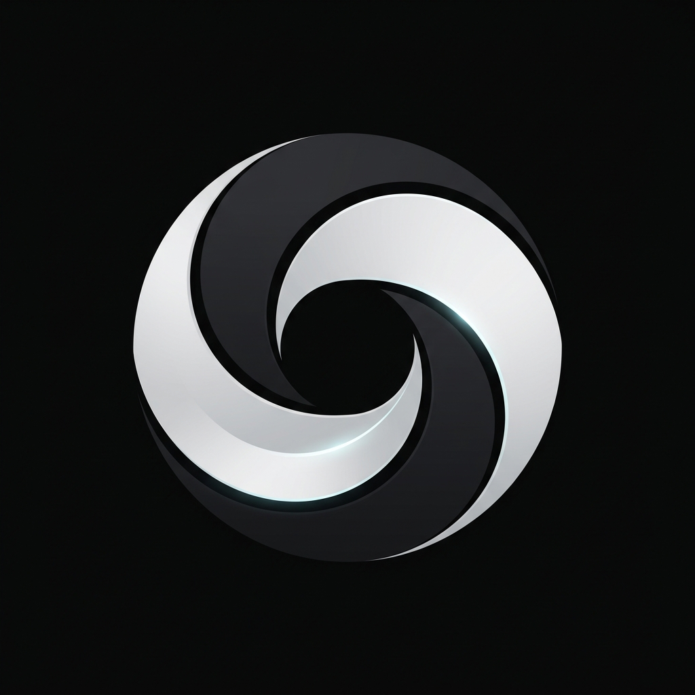
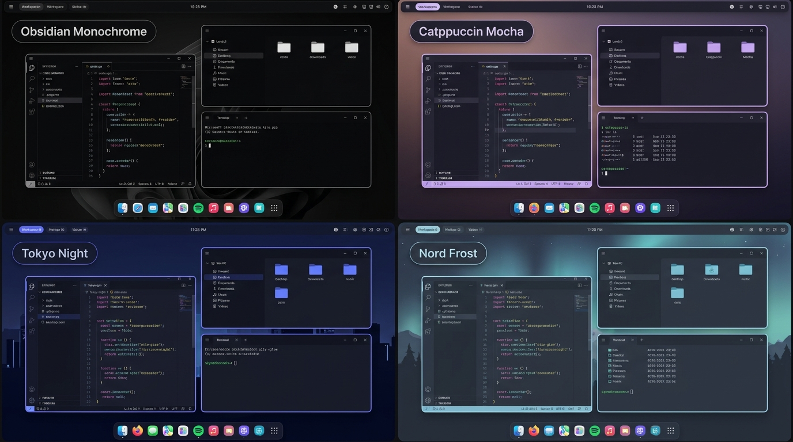
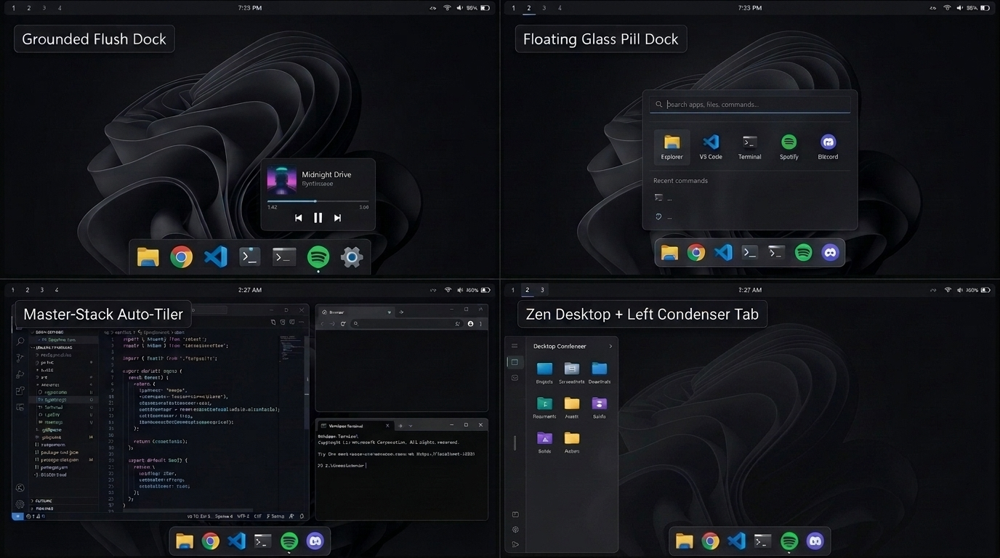

<div align="center">
  
  <h1>LensUI</h1>
  <p><strong>An open-source, obsidian-monochrome Windows 11 desktop shell with native Win32 speed, tactile physics, and local AI desktop control.</strong></p>

  <p>
    
    
    
    
    
  </p>
</div>

---

## Overview

**LensUI** transforms Windows 11 into a calm, ultra-responsive, keyboard-and-mouse-first desktop environment built on **Tauri v2 (Rust + Win32)** and **React 19**.

Every surface uses **Obsidian Monochrome Chrome** (`#09090b` / `#fafafa`) paired with **full-color app icons**, **0px-gap flush flow-outs**, **100% reversible OS hooks**, and a built-in **Local AI Action Router + DPO Training Dataset Logger**.

---

## Visual Showcase & Parity Boards

### Built-In Theme Packs


### Dock Styles & Desktop Architecture


See the full **[Theme Packs, Dock Styles & Desktop Suites Roadmap](./docs/THEMES_ROADMAP.md)** for all 18+ planned `.lenstheme` packs and parity testing checklists.

---

## Core Features

### Grounded Bottom Dock & Live Media
- **Auto-Imported Windows Pinned Apps:** Automatically mirrors your Windows Taskbar pins with pure, shortcut-arrow-free 48×48 icons (`SHIL_EXTRALARGE`).
- **Live Spotify Hover Card & Top Bar Controls:** Real Windows SMTC integration with album art thumbnail, `⏮ / ▶⏸ / ⏭` playback controls, and a 1-click **Pin to Top Bar** toggle.
- **Hover Window Switcher & Drag-to-Reorder:** Hover over File Explorer or any running dock icon to switch or close individual windows; drag icons directly to reorder; hover `×` to close apps.
- **In-Place Search:** The magnifying glass is a normal Dock icon, like the settings gear. Clicking it spreads a text box out of the icon across the Dock row and opens the Dock into search (Recent Files, Quick Folders, Installed Apps). The Dock keeps its width; your other icons slide to the right and stay clickable, shrinking only if the row would overflow.

### Natural-Language Action Router (Local AI)
Type compound natural-language commands directly inside **Dock Search**, **Top Bar Search**, or **Agent Chat**:
- `mute chrome, 40% brightness, catppuccin theme`
- `unmute spotify, 75% opacity, tile split`
- `organize windows, night light 60%`
- `next desktop`, `sharp corners`, `80% volume`, `pause spotify`

### Smart Window Organizer & Auto-Tiler
Real Win32 `SetWindowPos` tiling that respects your Top Bar and Bottom Dock insets:
- **Smart Group:** Clusters open windows (*Coding*, *Browser*, *Media & Comms*, *Files*), tiles the active group in Master-Stack, and minimizes clutter.
- **50/50 Split**, **Master-Stack (64/36)**, **2×2 Quad Grid**, and **3 Columns**.

### "Watch-Me-Once" Workflow Recorder + Local DPO Dataset (`dpo_pairs.jsonl`)
- Record real desktop workflows (app launches/focuses, brightness, volume, theme, opacity, and tiling steps) into 1-click replayable macros stored in `%APPDATA%\LensUI\training\macros.json`.
- Automatically logs accepted/rejected actions and **👍 / 👎** feedback into `%APPDATA%\LensUI\training\dpo_pairs.jsonl` — ready for local **Unsloth / LoRA / Ollama** fine-tuning.

### Native Win32 DWM & Desktop Integration
- Live **Window Opacity (`40–100%`)**, **Corner Roundness (`0–20px`)**, and **Traffic Light Caption Buttons** (`G·Y·R`, `R·Y·G`, or Native Windows).
- **Zen Desktop Condenser Tab:** Hides cluttered desktop icons into a wallpaper-only left-edge obsidian tab.
- **Smart Dodge Auto-Hide:** Both Top Bar and Bottom Dock automatically dodge overlapping windows and reveal smoothly on edge hover.

---

## Keyboard Shortcuts

| Shortcut | Action |
| :--- | :--- |
| `Alt + Space` | Toggle Lens Command Palette / Action Router |
| `Alt + W` | Toggle Widget Drawer & System Telemetry |
| `Esc` | Dismiss active Search Drawer, Palette, or Menu |

---

## Quick Start

### Prerequisites
- **Windows 11** (x64)
- **Rust** (stable MSVC toolchain)
- **Bun** (`https://bun.sh`)

### Run in Development
```bash
bun install
bun run tauri dev
```
Or double-click `Launch-Lens-UI.bat`.

### Build Release Installer
```bash
bun run build
bun run tauri build
```

---

## Safety & Privacy

LensUI is governed by [`AGENTS.md`](./AGENTS.md) and [`SECURITY.md`](./SECURITY.md):
- **Zero telemetry** — 100% local execution.
- **100% reversible OS hooks** — native Windows taskbar, desktop icons, and DWM styling auto-restore on exit, crash, or `Restore-Windows-Taskbar.bat`.
- **Anti-cheat safe** — games and anti-cheat processes are excluded from DWM hooks.

---

## License

MIT © 2026 LensUI Contributors. See [`LICENSE`](./LICENSE).
