<!-- The feature tour below is generated from tools/site/content/features.mjs by
     tools/site/gen-readme.mjs. Edit that file, then re-run the script. -->
<div align="center">
  <picture><source srcset="./docs/brand/lens-logo-anim.webp" media="(prefers-reduced-motion: no-preference)">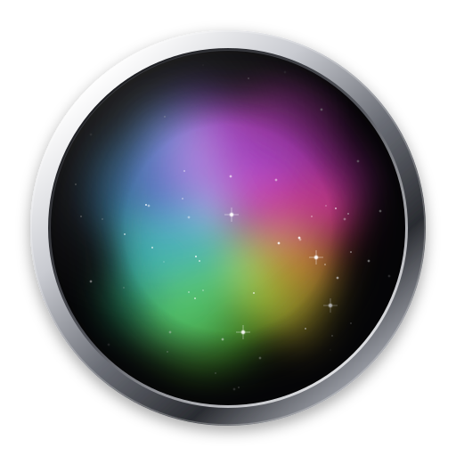</picture>
  <h1>Lens</h1>
  <p><strong>The everything desktop.</strong> The open-source desktop where look, apps and AI finally work as one.</p>
  <p>
    <a href="https://github.com/orionopenwow/LensUI/actions/workflows/build.yml"></a>
    <a href="./LICENSE"></a>
  </p>
  <p><a href="https://orionopenwow.github.io/LensUI/">Website</a> · <a href="https://orionopenwow.github.io/LensUI/#stage">Try it in your browser</a> · <a href="./docs/guide-for-users/README.md">User guide</a> · <a href="./docs/MASTERPLAN.md">Plan</a></p>
</div>

<p align="center">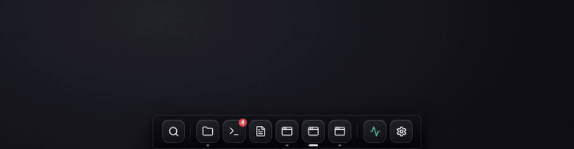</p>

> **Status: beta, not yet tested on many real machines.** Everything compiles and runs its tests on Windows in CI, and every surface renders in automated screenshot tests, but most features have only been tried on a few PCs. There is no signed installer yet. New features are off by default. Keep [`Restore-Windows-Taskbar.bat`](./Restore-Windows-Taskbar.bat) handy while you try it.
>
> The clips in this README are rendered from the real Lens interface in a headless browser; the Windows side (other apps, the real desktop) is simulated in them. Recordings from real Windows machines will replace them.

## What Lens is

Lens is the everything desktop for Windows 10 and 11: macOS's docks, Linux's theming, a launcher like Raycast and an AI co-pilot, rebuilt as one open-source app. That means a dock with real magnification, theme packs that restyle every surface (including other apps' window frames), a launcher that understands plain requests, and an AI co-pilot that runs on your PC or with Claude and asks before it acts. It sits on top of Windows Explorer instead of patching it: features stay off until you turn them on, and every change undoes.

Built with [Tauri 2](https://tauri.app) (Rust and Win32) and React. Try the dock and themes on the [website](https://orionopenwow.github.io/LensUI/).

## Feature tour

### Dock

Six dock styles with the same physics, and search that opens inside the dock.

<p align="center"></p>

- Floating, Slim, Taskbar (a Windows 11-style bar), Studio, Minimal and Split, on any screen edge.
- Optional macOS-style magnification, bounce or jelly launch animations, app labels and a minimise pulse.
- Search spreads out of the magnifier inside the dock. The dock never gets wider and your icons stay visible.

More: [DOCK_STYLES.md](./docs/DOCK_STYLES.md)

### Themes & look

Eighteen theme packs that restyle the dock, bar, panels and app window frames together.

<p align="center">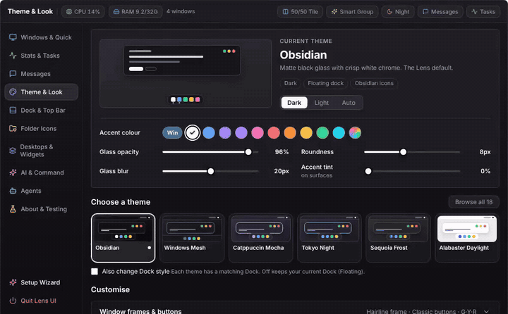</p>

- Catppuccin, Tokyo Night, Nord, Dracula, Gruvbox, Solarized, Rosé Pine and more, using their real palettes.
- Every pack passes a 4.5:1 contrast check for body text. Day and night schedules switch packs for you.
- Export your look as a .lenstheme file and share it. Importing checks every value first.

More: [THEMES_ROADMAP.md](./docs/THEMES_ROADMAP.md)

### Windows

Window frames, focus dimming, hot corners and Alt+drag, all off until you turn them on.

<p align="center">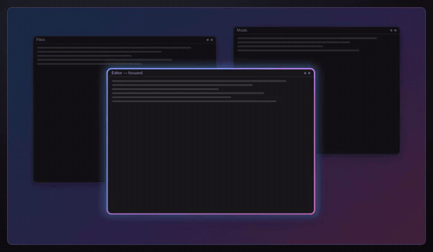</p>

- Dim inactive windows and put a solid or gradient border on the active one. Pin any window on top.
- Hot corners, Alt+drag to move and Alt+right-drag to resize any window, and summon-an-app hotkeys.
- Workspaces with an Overview you can drag windows between. Full-screen apps and games are left alone.

More: [WINDOW_STYLING.md](./docs/WINDOW_STYLING.md) · [PRODUCTIVITY.md](./docs/PRODUCTIVITY.md)

### Living desktop

Playground scenes run as your wallpaper. Some are calm, some you can play with.

<p align="center">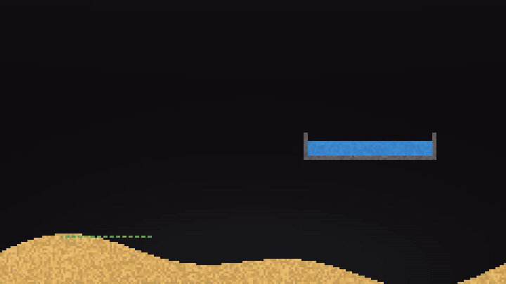</p>

- Falling Sand, Ink, Flow Field, Constellation, Aurora, Rain on Glass, Starfield and Sky Clock, coloured by your theme.
- Click ripples on empty desktop, an idle-mode screensaver and a different scene per workspace.
- Scenes pause when a game or full-screen app is in front, and Calm freezes them into a still picture.

More: [PLAYGROUND.md](./docs/PLAYGROUND.md)

### Pointer suite

Six pointer families drawn in your accent colour, every Windows mouse setting, and pointer effects.

<p align="center">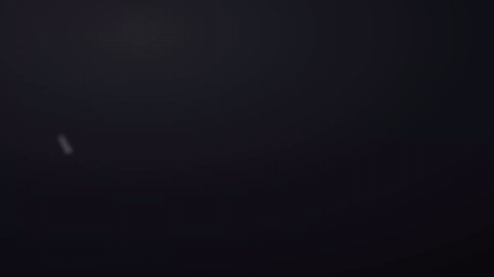</p>

- Obsidian, Accent, Glass, Minimal dot, Outline and Retro pixel, sharp from 32 to 128 px.
- Click ripples, glow and comet trails, a spotlight, shake to find and an on-screen shortcut display.
- Your original pointers and mouse settings are saved first, and one button puts them back.

More: [CURSORS.md](./docs/CURSORS.md)

### Lens Command, Shelf & right-click

One place for context: a standing clipboard, a pocket command bar and the same right-click menu everywhere.

<p align="center">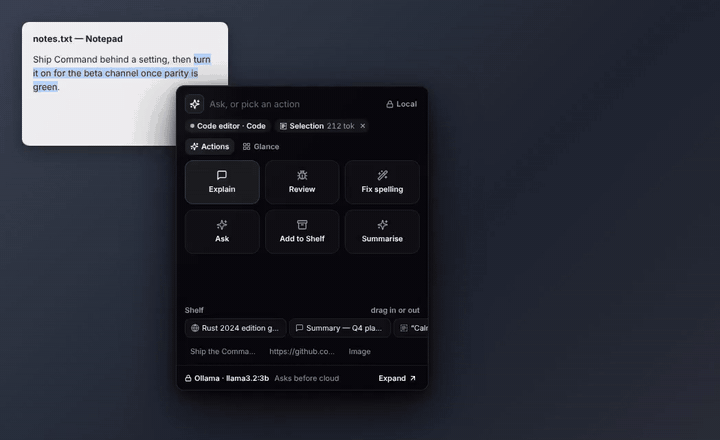</p>

- Lens Mini opens at your pointer and expands into Lens Command: one thread for answers, actions and approvals.
- The Shelf keeps selections, pages, files and transcripts. Clipboard history is encrypted and skips password managers.
- Right-click in the browser and File Explorer: summarise, translate, add to Shelf or pack it as context for Claude.

_Context packs, micro-saves and the shared action catalogue are in pull request #19._

More: [COMMAND.md](./docs/COMMAND.md) · [SHELF.md](./docs/SHELF.md) · [BROWSER_BRIDGE.md](./docs/BROWSER_BRIDGE.md)

### Voice

> **In development** — in [pull request #23](https://github.com/orionopenwow/LensUI/pull/23), not in a build yet.

"Lens, minimise this." Push-to-talk by default, recognised on your PC.

<p align="center">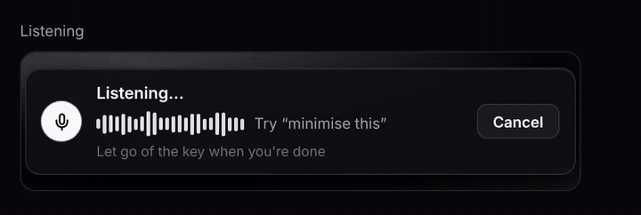</p>

- Windows, apps, workspaces, themes, volume, timers, the Shelf and questions, with confirm and undo.
- Speech is recognised locally with whisper.cpp. Audio is never saved or sent anywhere.
- "Hey Lens" is opt-in and pauses in calls, games, full-screen apps and on the lock screen.

### Lens Browser

> **In development** — in [pull request #20](https://github.com/orionopenwow/LensUI/pull/20), not in a build yet.

A light WebView2 browser with spaces, vertical tabs and an agent that stops for your OK.

<p align="center">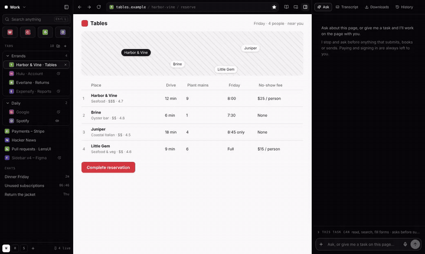</p>

- Spaces with their own profiles, vertical tabs that sleep when idle, reader view and picture-in-picture.
- YouTube transcripts with timestamps you can click, summarise or add to the Shelf.
- Submit, book, send and delete always ask first. Passwords, payments and CAPTCHAs are never touched.

### AI helper & approvals

Off until you turn it on. Local first, Claude when you choose, and nothing happens without your OK.

<p align="center">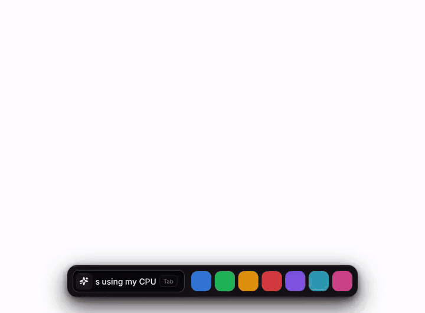</p>

- An instant offline command engine (no model), your own local model through Ollama or LM Studio, or Claude with your key.
- Every cloud request shows exactly what it would send. The usage log never stores your text.
- Risky steps show a Needs your OK card: what it will click, the details, Deny or hold to approve.

_The unified approval card and Claude control over every setting are in pull request #21._

More: [AI.md](./docs/AI.md) · [AI_SURFACES.md](./docs/AI_SURFACES.md) · [MCP.md](./docs/MCP.md)

### Lens Snip

> **In development** — in [pull request #24](https://github.com/orionopenwow/LensUI/pull/24), not in a build yet.

Capture, then do the useful part before anything is saved.

<p align="center">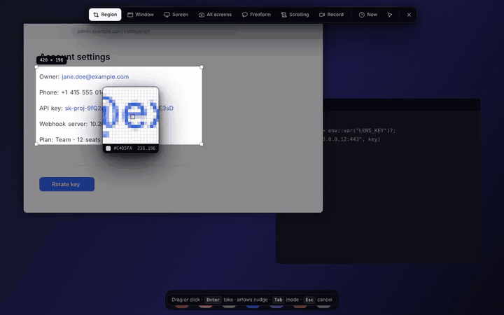</p>

- Region, window or screen, with a loupe. Annotate, blur and number steps before you save.
- Auto-redaction suggests blurring e-mails, API keys and card-like numbers it finds in the image.
- One key to copy, copy text, pin to screen, add to the Shelf or paste to Claude with what is sent shown first.

### Ask Lens

> **In development** — in [pull request #18](https://github.com/orionopenwow/LensUI/pull/18), not in a build yet.

"How do I…?" answered from Lens's own settings, with Show me.

<p align="center">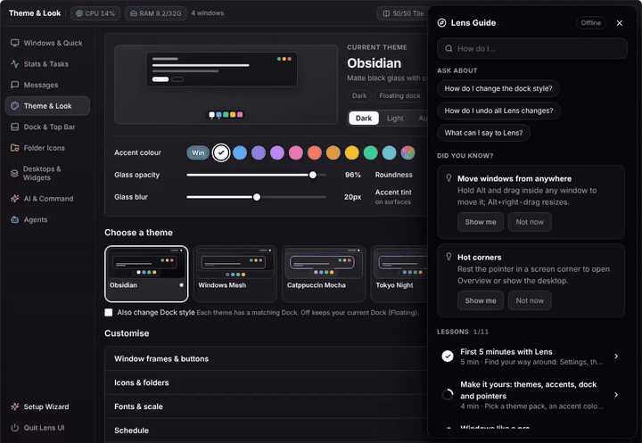</p>

- An offline index of every setting, theme, dock style, command and shortcut. It only knows things that exist.
- Show me opens the right Settings tab and highlights the setting.
- Eleven short lessons that notice when you have done each step.

### Tester Hub

For people testing Lens builds: what changed, what to test today and a report you can send.

<p align="center">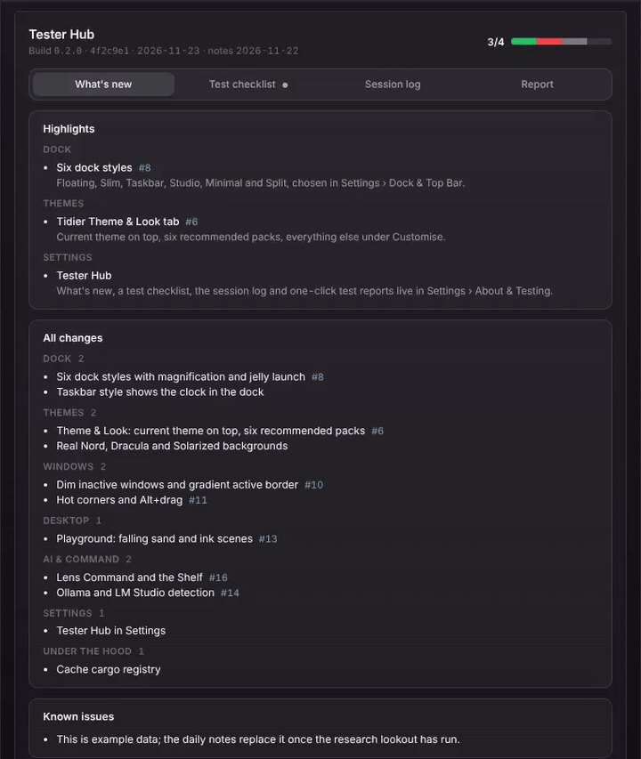</p>

- What's new in this build, grouped by area, and today's checklist with Pass, Fail and Skip.
- A session log with personal details hidden, and Mark moment (Ctrl+Alt+M) while you test.
- Export one zip with results and PC details. API keys, paths and clipboard contents are stripped.

More: [TESTER_HUB.md](./docs/TESTER_HUB.md)

## Trust model

- **Off until you turn it on.** New features ship disabled. Your desktop only changes when you ask it to.
- **Every change can be undone.** Lens records what it changes and puts it back. Remove all Lens changes is one button.
- **Games are left alone.** No injection into other processes. Overlays and hooks pause for full-screen apps and anti-cheat games.
- **Local first.** The command engine and Guide work offline. Cloud AI is opt-in and shows what it would send.
- **Open source.** MIT licensed. Releases are signed, and you can build every part yourself.

Restore scripts work even when Lens isn't running: [`Restore-Windows-Taskbar.bat`](./Restore-Windows-Taskbar.bat), [`Restore-Windows-Shell.bat`](./Restore-Windows-Shell.bat) and [`Uninstall-Lens-UI.bat`](./Uninstall-Lens-UI.bat). No telemetry and no account.

**Seeing "Hmmm… can't reach this page / localhost refused to connect" windows over your desktop?** A development build of Lens was started without its dev server. Run [`Fix-My-Desktop.bat`](./Fix-My-Desktop.bat): it closes Lens, stops it starting at sign-in and brings Explorer back. Then build the standalone version with `Build-Lens-UI.bat` and turn on Start with Windows from that copy.

## Works on

| Feature | Windows 10 | Windows 11 |
| :--- | :--- | :--- |
| Dock, Top Bar, themes, Playground, Command, Shelf | Windows 10 (1809+) and 11 | Windows 10 (1809+) and 11 |
| Dark title bars on other apps | Yes (1809+) | Yes |
| Window frame colours and rounded corners | No | Yes |
| Glass backdrops (Mica / acrylic) | No | 22H2 and later |
| Pointer size (CursorBaseSize) | 1903+ | Yes |

Expected support, based on the Windows features each part uses; real-machine testing is ongoing. Linux and macOS: the interface runs and CI compile-checks the Rust on both, but real support needs a platform layer (see the [plan](./docs/MASTERPLAN.md)).

## Install

There is no signed release yet. Until there is, build from source.

Requirements: Windows 10 (1809 or newer) or Windows 11, the [Rust toolchain](https://www.rust-lang.org/tools/install) (stable, MSVC) and [Bun](https://bun.sh).

```bat
git clone https://github.com/orionopenwow/lensui
cd lensui
bun install
bun run tauri dev
```

Or double-click `Launch-Lens-UI.bat` for development mode and `Build-Lens-UI.bat` for a standalone build (written to `src-tauri\target\release\bundle`).

After the first launch, open Settings and press **Run self-test**. If anything looks wrong, attach the report to an [issue](https://github.com/orionopenwow/LensUI/issues). Testers: Settings › About & Testing has today's checklist and a one-click report.

## Documentation

- [User guide](./docs/guide-for-users/README.md): short how-tos for every area, generated from Lens's own settings.
- [Website](https://orionopenwow.github.io/LensUI/): the real dock with super search, a guided tour, live themes, Ask Lens and the open-source apps.
- Reference: [Dock styles](./docs/DOCK_STYLES.md) · [Window styling](./docs/WINDOW_STYLING.md) · [Productivity](./docs/PRODUCTIVITY.md) · [Playground](./docs/PLAYGROUND.md) · [Pointers](./docs/CURSORS.md) · [AI](./docs/AI.md) · [Command](./docs/COMMAND.md) · [Shelf](./docs/SHELF.md) · [Browser bridge](./docs/BROWSER_BRIDGE.md) · [Transcription](./docs/TRANSCRIPTION.md) · [MCP](./docs/MCP.md) · [Plugins](./docs/PLUGINS.md) · [Shell mode](./docs/SHELL_MODE.md)
- Project: [Master plan](./docs/MASTERPLAN.md) · [Roadmap](./docs/ROADMAP.md) · [Design system](./DESIGN.md) · [Releasing](./docs/RELEASING.md) · [Tester Hub](./docs/TESTER_HUB.md) · [Media](./docs/media/README.md)

## Contributing

Issues and pull requests are welcome. Before opening a pull request:

- Read [AGENTS.md](./AGENTS.md): never touch user files outside `%APPDATA%\LensUI\` without confirmation, and keep every OS change reversible.
- Run `bun run build` and `bun run test`, and on Windows `cargo clippy` and `cargo test` in `src-tauri`.
- CI renders every surface in a headless browser and fails on crashes or console errors; look at its screenshots for visual changes.

See [CONTRIBUTING.md](./CONTRIBUTING.md) and [SECURITY.md](./SECURITY.md).

## License

[MIT](./LICENSE). Lens is not affiliated with Microsoft or Anthropic.
