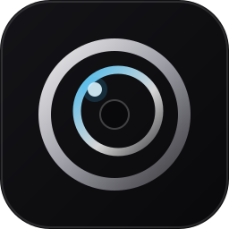
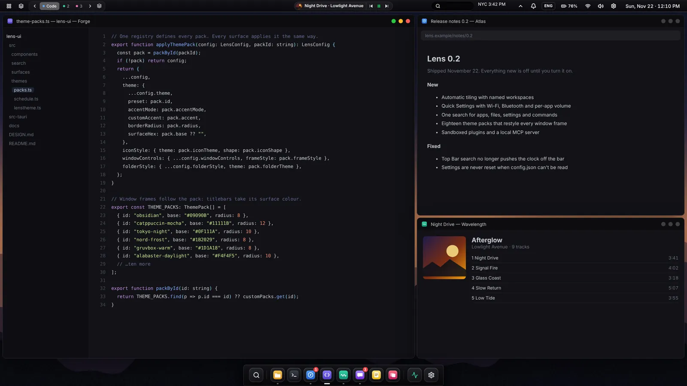
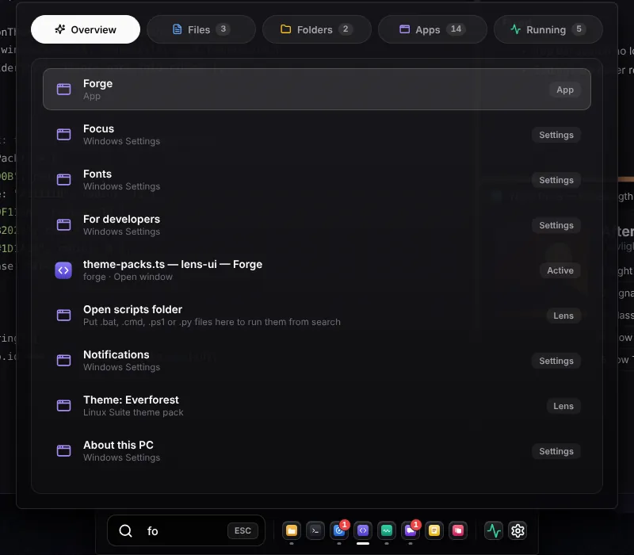
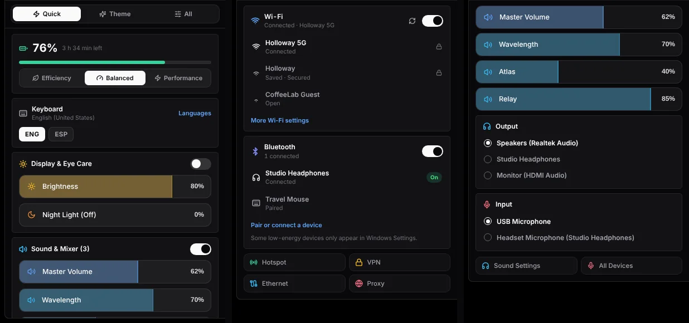
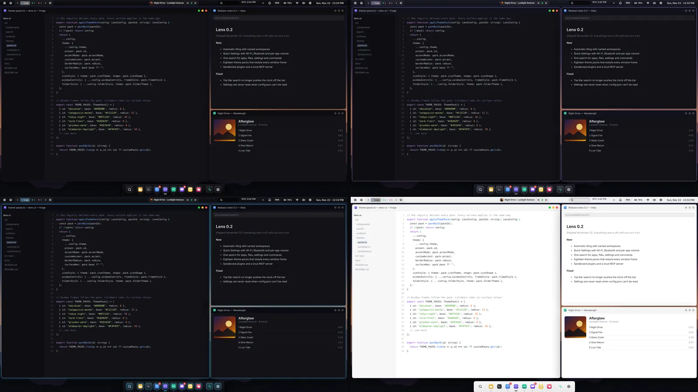
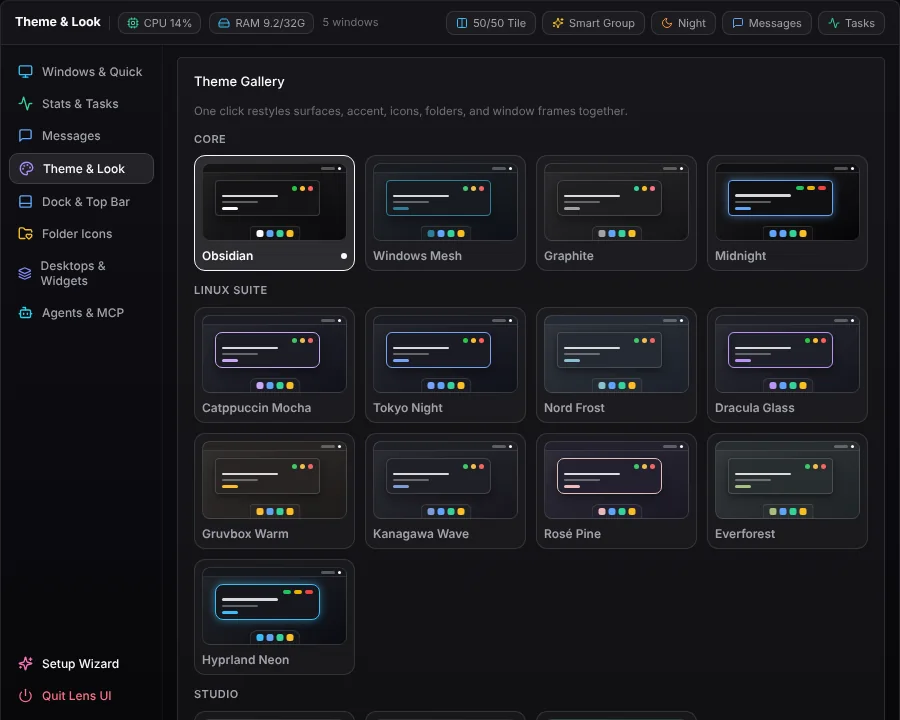
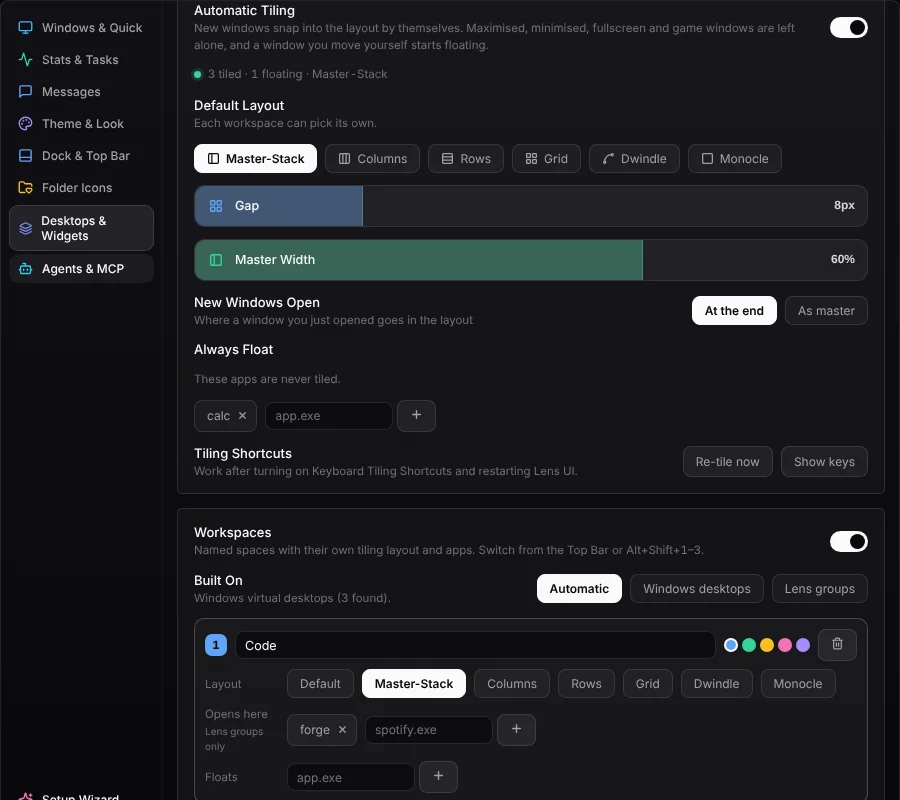
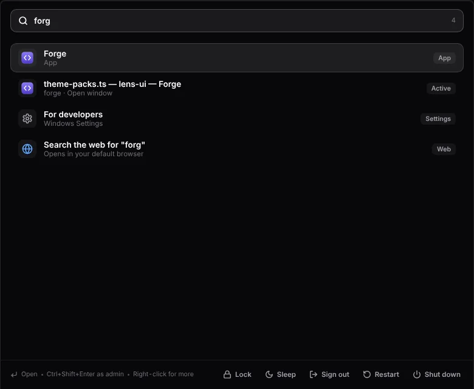

<div align="center">
  
  <h1>Lens UI</h1>
  <p>A Dock, a Top Bar and theme packs for Windows 10 and 11. Open source and reversible.</p>
  <p>
    <a href="https://github.com/orionopenwow/lensui/actions/workflows/build.yml"></a>
    <a href="./LICENSE"></a>
  </p>
  <p><a href="https://orionopenwow.github.io/lensui/">Website</a> · <a href="https://orionopenwow.github.io/lensui/docs/">Docs</a> · <a href="./docs/ROADMAP.md">Roadmap</a></p>
</div>

> **Status: early preview.** The whole app compiles on Windows in CI and every surface renders in automated tests, but most features have not yet been tried on a wide range of real machines. There is no signed installer yet. Experimental features (tray hosting, live wallpaper, shell replacement, plugins, the MCP server) are off by default. Keep [`Restore-Windows-Taskbar.bat`](./Restore-Windows-Taskbar.bat) handy while you try it.



## Why Lens

The Windows taskbar does a lot of things adequately and few things well. Lens replaces it with a Dock and a Top Bar that are fast to read, put real system controls one click away, and keep the whole desktop in one visual language, including the frames of other apps' windows. It runs on top of Explorer instead of patching it, so quitting Lens puts Windows back the way it was.

Lens is built with [Tauri 2](https://tauri.app) (Rust and Win32) and React.

## What it does

### Dock and search

Click the magnifier and a text box spreads out of it; the Dock keeps its size and your apps stay visible. One ranked search covers apps, open windows, files, folders and Windows settings, tolerates typos, learns from what you pick, and answers `2+2*3`, `72 f to c` or `15% of 80` inline. Apps can be pinned and reordered by dragging, and show unread-notification badges.



### Quick Settings

Quick Settings drops from the Top Bar and talks to Windows directly: Wi-Fi networks and saved-profile connect, paired Bluetooth devices, per-app volume, output and microphone switching, battery and power mode, keyboard layouts, brightness and Night Light.



### Theme packs

A theme pack sets surface colour, accent, corner radius, icon style, folder icons and window frames together. There are 18 built in, including Catppuccin Mocha, Tokyo Night, Nord, Rosé Pine and two light packs. Looks can be saved as `.lenstheme` files, scheduled for day and night, and follow Windows' contrast and reduced-motion settings.





### Tiling and workspaces

Optional automatic tiling with master-stack, columns, grid, dwindle and monocle layouts. Maximised, fullscreen and game windows are left alone. Named workspaces carry their own layout and apps, and a set of apps can be saved as a session and restored, tiled, in one click.



### Launcher

Every installed app in a grid with pinned and recent rows; typing turns it into the same ranked search as the Dock. `Ctrl+Shift+Enter` runs an app as administrator, `>` runs a command and `?` searches the web. Power actions and commands always ask before they run.



### Also included

- Overview of open windows grouped by app, and a command palette.
- Notification centre with Windows toasts mirrored into Lens.
- Desktop widgets, clipboard history (off by default) and folder icon styling.
- Sandboxed plugins ([docs/PLUGINS.md](./docs/PLUGINS.md)) and an MCP server so AI apps on your machine can manage windows and themes ([docs/MCP.md](./docs/MCP.md)). Both off by default.
- Optional shell mode that runs Lens instead of Explorer ([docs/SHELL_MODE.md](./docs/SHELL_MODE.md)).

## Safety model

Lens is meant to be safe to try and easy to leave.

- **Reversible.** Quitting restores the taskbar, desktop icons and window styling, and a crash handler does the same if Lens fails. Lens keeps its own data in `%APPDATA%\LensUI`.
- **No injection by default.** Window frames are styled from outside other apps' processes. The older in-process helper DLL is off unless you enable it.
- **Games and anti-cheat are excluded.** Known anti-cheat processes and fullscreen games are skipped by window styling and tiling; you can add your own exclusions.
- **Your files stay put.** Folder icon changes back up the original `desktop.ini`. Desktop groups are a view and never move files.
- **Restore scripts that work without Lens running:**
  - [`Restore-Windows-Taskbar.bat`](./Restore-Windows-Taskbar.bat) brings back the Windows taskbar.
  - [`Restore-Windows-Shell.bat`](./Restore-Windows-Shell.bat) puts Explorer back as the shell if you used shell mode.
  - [`Uninstall-Lens-UI.bat`](./Uninstall-Lens-UI.bat) reverts folder icons, startup entries, shell mode and window styling, and asks before deleting Lens's settings.
- **One button in the app.** Control Center → "Remove all Lens changes" does the same as the uninstall script.

No telemetry and no account. Lens only goes online for things you open yourself, such as a web search or a messaging web app.

## Works on

| Feature | Windows 11 | Windows 10 (1809+) | Linux, macOS |
| :--- | :--- | :--- | :--- |
| Dock, Top Bar, Launcher, Overview, Quick Settings | Yes | Yes | Planned |
| Theme packs, search, plugins, workspaces, tiling | Yes | Yes | Planned |
| Dark titlebars on every app | Yes | Yes | — |
| Window frame colours and rounded corners | Yes | No (Windows 11 only) | — |
| Glass (Mica / acrylic) | Planned (22H2 and later) | No | — |

Expected support, based on the Windows features each part of Lens uses; testing on real machines is ongoing. Linux and macOS: the interface already runs there, and every Windows module has a portable stand-in that CI compile-checks on each change. Real support needs a platform layer, which is on the [roadmap](./docs/ROADMAP.md).

## Build from source

Requirements: Windows 10 (1809 or newer) or Windows 11, the [Rust toolchain](https://www.rust-lang.org/tools/install) (stable, MSVC) and [Bun](https://bun.sh).

```bat
git clone https://github.com/orionopenwow/lensui
cd lensui
bun install
bun run tauri dev
```

Or double-click `Launch-Lens-UI.bat` for development mode, and `Build-Lens-UI.bat` for a standalone build. The installer is written to `src-tauri\target\release\bundle`.

After first launch, open Control Center and press **Run self-test**. If anything looks wrong, attach the report to an [issue](https://github.com/orionopenwow/lensui/issues).

## Shortcuts

| Keys | Action | Default |
| --- | --- | --- |
| `Alt+Space` | Command palette | On |
| `Alt+W` | Widgets | On |
| `Ctrl+Shift+Enter` (in the Launcher) | Run as administrator | On |
| `Alt+1` … `Alt+9` | Open the Nth Dock app | Off |
| `Ctrl+Alt+Arrows`, `U` `I` `J` `K` | Snap to halves and quarters | Off |
| `Alt+Shift+Arrows` | Move focus between tiled windows | Off |
| `Ctrl+Alt+Space` | Next tiling layout | Off |

Global shortcuts that take keys away from other apps stay off until you enable them in Control Center.

## Roadmap

See [docs/ROADMAP.md](./docs/ROADMAP.md). The design rules every surface follows are in [DESIGN.md](./DESIGN.md).

## Contributing

Issues and pull requests are welcome. Before opening a PR:

- Read [AGENTS.md](./AGENTS.md) for the guardrails: never touch user files outside `%APPDATA%\LensUI\` without confirmation, and keep every OS change reversible.
- Run `bun run build` and, on Windows, `cargo clippy` in `src-tauri`.
- CI renders every surface in a headless browser and fails on crashes or console errors; check its screenshots for visual changes.

## License

[MIT](./LICENSE). Lens UI is not affiliated with Microsoft.
