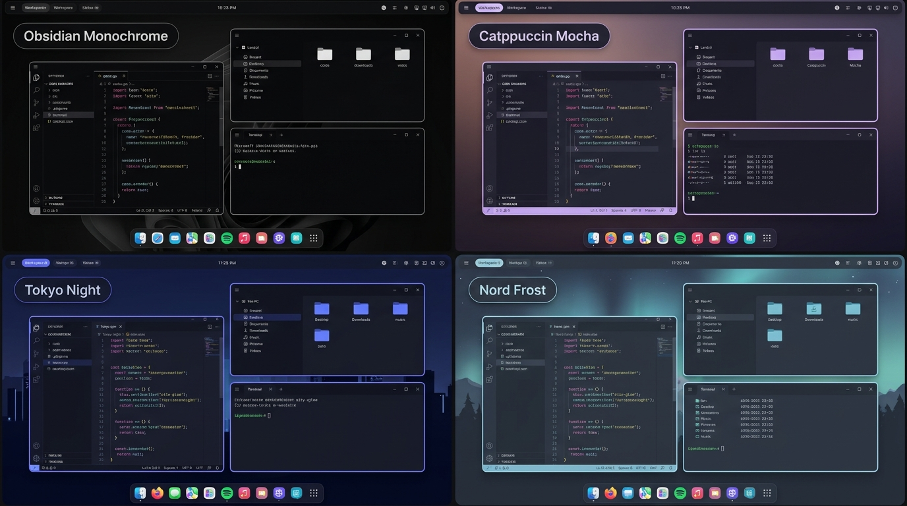
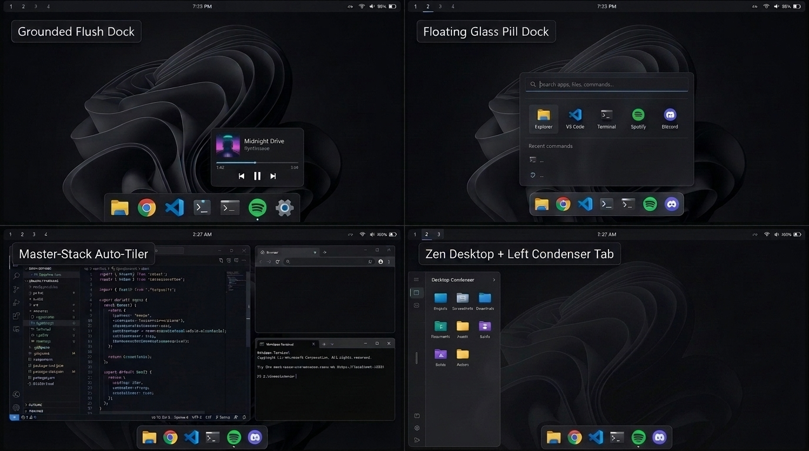

# LensUI — Theme Packs, Dock Styles & Desktop Suites Roadmap

> **Goal:** Ship LensUI with a curated library of **18+ built-in Theme Packs**, **6 Dock Styles**, and **5 Desktop Suites**, each verified against visual parity reference boards so every preset feels native, cohesive, and ultra-legible on Windows 11.

---

## Visual Parity Reference Boards

### Core Theme Packs Parity Board

### Dock & Desktop Architecture Parity Board

---

## 1. Built-In Theme Packs Catalog (`.lenstheme`)

| Tier | Theme Pack | Surface Base | Primary Accent | Corner Radius | Icon Theme | Status |
| :--- | :--- | :--- | :--- | :---: | :--- | :--- |
| **Core** | **Obsidian Monochrome** | `#09090b` | `#fafafa` | `8px` | Obsidian Squircle | ✅ Built-in |
| **Core** | **Midnight Pitch** | `#050507` | `#e4e4e7` | `8px` | Matte Monochrome | ✅ Built-in |
| **Core** | **Graphite Studio** | `#141417` | `#d4d4d8` | `10px` | Obsidian Squircle | ✅ Built-in |
| **Core** | **Windows Mesh** | `#0d1017` | Live OS Accent | `8px` | Accent Duotone | ✅ Built-in |
| **Linux Suite** | **Catppuccin Mocha** | `#11111b` | `#cba6f7` | `12px` | Frosted Glass | ✅ Built-in |
| **Linux Suite** | **Tokyo Night** | `#0f111a` | `#7aa2f7` | `10px` | Obsidian Squircle | ✅ Built-in |
| **Linux Suite** | **Nord Frost** | `#1b2029` | `#88c0d0` | `8px` | Frosted Glass | ✅ Built-in |
| **Linux Suite** | **Dracula Glass** | `#14151f` | `#bd93f9` | `10px` | Accent Duotone | ✅ Built-in |
| **Linux Suite** | **Gruvbox Warm** | `#1d1a18` | `#fabd2f` | `8px` | Matte Monochrome | ✅ Built-in |
| **Linux Suite** | **Kanagawa Wave** | `#16161d` | `#7e9cd8` | `10px` | Obsidian Squircle | ✅ Built-in |
| **Linux Suite** | **Rosé Pine** | `#191724` | `#ebbcba` | `12px` | Frosted Glass | ✅ Built-in |
| **Linux Suite** | **Everforest Dark** | `#1e2326` | `#a7c080` | `8px` | Matte Monochrome | ✅ Built-in |
| **Linux Suite** | **Hyprland Neon** | `#0a0c12` | `#38bdf8` | `14px` | Accent Duotone | ✅ Built-in |
| **Studio** | **macOS Sequoia Frost** | `#141519` | `#0a84ff` | `14px` | Native Full-Color | ✅ Built-in |
| **Studio** | **Cyberpunk Amber** | `#0d0b09` | `#f59e0b` | `4px` | Obsidian Squircle | ✅ Built-in |
| **Studio** | **Solarized Matte** | `#07242b` | `#2aa198` | `8px` | Matte Monochrome | ✅ Built-in |
| **Light** | **Alabaster Daylight** | `#f4f4f5` | `#18181b` | `10px` | Native Full-Color | 🧪 First cut — needs visual pass |
| **Light** | **Paper Minimal** | `#fafaf9` | `#2563eb` | `8px` | Borderless | 🧪 First cut — needs visual pass |

---

All built-in packs are defined in one place: `src/themes/packs.ts`. Light packs are a first cut and need a visual pass (see `ROADMAP.md`).

---

## 2. Dock Styles

1. **Grounded Flush Dock (Default):** Anchored `0px` flush to the bottom edge with rounded top corners, seamless `0px`-gap Control Center & Search flow-out, full-color icons, live Spotify hover card, and hover window switcher.
2. **Floating Glass Pill:** Elevated `10px` off the bottom edge with all-around rounded corners and deep ambient shadow.
3. **Edge-to-Edge Studio Bar:** Full-width obsidian taskbar replacement with centered app icons, left launcher, and right telemetry/clock.
4. **Minimalist Icon Strip:** Ultra-compact `34px` borderless icons with zero background chrome until hovered.
5. **Split Utility Dock:** Separate left/center app pill and right quick-controls/media pill.
6. **Auto-Hide Smart Dodge:** Automatically hides when any maximized or overlapping window touches the dock zone and reveals within `80ms` at the bottom edge.

---

## 3. Desktop Styles & Tiling Workflows

1. **Zen Desktop + Left Condenser Tab (Default):** Hides cluttered desktop icons into a wallpaper-only left-edge obsidian tab that auto-hides whenever an app window covers it.
2. **Master-Stack Auto-Tiler:** `64%` primary editor/app on the left + `36%` stacked secondary apps on the right, respecting Top Bar and Bottom Dock insets.
3. **50/50 Dual Split:** Instant side-by-side layout for code + browser or docs + notes.
4. **2×2 Quad Grid & 3-Column Ultrawide:** Multi-monitor and ultrawide productivity grids.
5. **Smart Category Focus:** Automatically groups windows (*Coding*, *Browser*, *Media & Comms*, *Files*), tiles the active group, and minimizes unrelated clutter.

---

## 4. Parity Testing Checklist

Every built-in `.lenstheme` pack is parity-tested against its reference board before release:
- [ ] **Contrast & Legibility:** Primary text ≥ 7:1 contrast; muted metadata ≥ 4.5:1 across `40–100%` opacity.
- [ ] **Full-Color Dock Icons:** Zero monochrome/grayscale filters on app icons; zero Windows `.lnk` shortcut arrow overlays.
- [ ] **0px Flush Flow-Outs:** Control Center, Quick Settings, and Search Drawer fuse cleanly to the Dock/Top Bar with zero visible seam.
- [ ] **Live DWM Harmony:** Third-party Windows 11 apps inherit matching dark titlebars, corner roundness, and live opacity without touching anti-cheat processes.
- [ ] **Clean Exit Restore:** Quitting LensUI restores native Windows taskbar, desktop icons, and DWM attributes cleanly.
