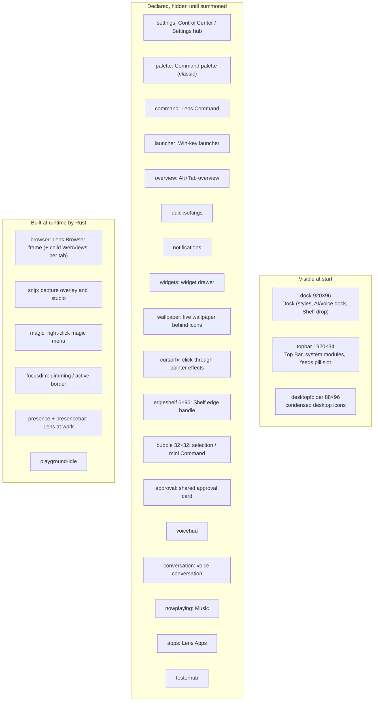
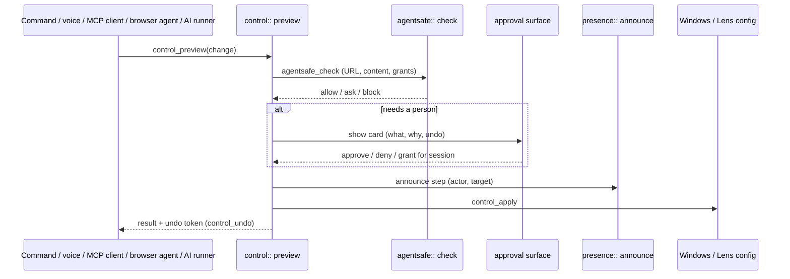

# Architecture

Written against `main` at `5a4a5b2`. Inventories that change often are generated: `generated/commands.md` (every IPC command), `generated/windows.md` (windows and routes), `generated/loc.md` (size). This file explains how the pieces fit.

## 1. Process and window model

Lens is **one Rust process** (`lens-ui.exe`) hosting **many WebView2 windows**. Every window loads the same `index.html?surface=<id>`; `src/main.tsx` maps the id to a lazily imported React tree, so a window only pays for its own code. Most windows are transparent, frameless, skip the taskbar and are shown, hidden and positioned from Rust.

| Surface | Route module | Purpose |
|---|---|---|
| `dock` | `surfaces/DockSurface` | The dock: pinned/running apps, styles (`dock/`), AI and voice docks, previews, drop targets. |
| `topbar` | `surfaces/TopBarSurface` | Menu bar: clock/calendar, system modules, search, tray host icons. |
| `settings` | `surfaces/ControlCenterSurface` | The Settings hub (`settings/pages/*`, `themeux/ThemeTab`). |
| `palette` | `surfaces/CommandPaletteSurface` | The original command palette. |
| `command` | `command/CommandSurface` | Lens Command: ask/do, context chips, plans, approvals. |
| `bubble` | `command/mini/BubbleSurface` | Mini Command / selection bubble. |
| `edgeshelf` | Shelf edge handle | Opens the Shelf from the screen edge. |
| `launcher`, `overview` | `surfaces/*` | Win-key launcher and Alt+Tab overview (keyhook, opt-in). |
| `quicksettings`, `notifications`, `widgets` | `surfaces/*` | Flyouts from the top bar. |
| `wallpaper`, `cursorfx` | `surfaces/*` | Live wallpaper (Playground/ambient scenes) and pointer effects. |
| `desktopfolder` | `surfaces/DesktopFolderSurface` | Condensed desktop icons. |
| `approval` | `approval/ApprovalSurface` | Shared human-in-the-loop card for agent actions. |
| `presence`, `presencebar` | `presence/*` | Ghost cursor, step chips and the "Lens at work" bar. |
| `browser` | `browser/BrowserSurface` | Lens Browser chrome; pages are separate WebView2 controllers owned by Rust. |
| `snip`, `magic` | `snip/SnipSurface`, `magic/MagicSurface` | Capture and the magic menu. |
| `nowplaying`, `apps`, `testerhub` | `music/`, `apps/`, `tester/` | Music, Lens Apps, Tester Hub. |
| `voicehud`, `conversation` | `surfaces/VoiceHudSurface`, `surfaces/Conversation…` | Voice HUD and conversation mode. |
| `focusdim`, `playground-idle` | `surfaces/FocusDimSurface`, playground | Overlays. |

`PresenceTwin` is lazily mounted inside other surfaces so the presence cursor can appear in-window.

## 2. Rust module map (`src-tauri/src`, ~105k lines)

**Entry and wiring**
- `main.rs` → `lib.rs::run()`: plugin setup, `generate_handler!` (564 commands), shutdown.
- `app/` — process-wide state and startup: `setup.rs` (hotkeys, initial windows, engines by config flag), `integration.rs` (feature init/shutdown order), `tray.rs`, `watcher.rs` (config file and display watchers).
- `config.rs` — `LensConfig` (serde, versioned), `config_dir()` = `%APPDATA%\LensUI`.
- `commands/*.rs` — thin `#[tauri::command]` layer, one file per area (41 files).
- `ffi.rs` — shared raw Win32 declarations.

**Shell and windows (`win_*.rs`)**
- `win_shell` opt-in shell replacement; `win_taskbar` hide/show native taskbar and desktop icons, run-on-startup, console handler; `win_tray` system-tray host.
- `win_dwm_engine` window styling engine (DWM attributes per window, optional global `WH_CALLWNDPROC` hook DLL); `win_caption_engine` caption colour sampling; `win_theme` feature support by OS build; `win_glass` DWM backdrop for flyouts; `win_focus_dim` dimming, active border, peek, pin on top; `win_rules` per-app rules; `win_traffic` traffic-light buttons target.
- `win_tiler` tiling and snap layouts; `win_workspaces` workspaces/virtual desktops; `win_monitors` monitor math; `win_summon` app-summon hotkeys; `win_altdrag` Alt+drag move/resize; `win_hotcorners` hot corners (polling thread); `win_keyhook` Win key → launcher, Alt+Tab → overview; `win_events` out-of-process window event tracker; `win_windows` window/app helpers; `win_previews` dock thumbnails (DWM thumbnails in a host window).
- `win_wallpaper` wallpaper engine and Playground blobs; `win_desktop_input` desktop input for living wallpapers; `win_cursors` code-drawn cursor themes and pointer settings; `win_cursor_fx` pointer effects overlay.
- `win_folders` folder icons (`desktop.ini`, Shell Icons override); `win_themes` `.lenstheme` files; `win_windhawk` optional Windhawk mod sync.
- `win_notifications` notification center and DND; `win_quick_settings` gamma night light etc.; `win_system_modules` battery, Wi-Fi, Bluetooth, audio, brightness; `win_media` media session thread; `win_clipboard` clipboard history v1; `win_search` file index, ranking, user scripts.
- `win_mcp` MCP server (stdio) and agents registry; `win_plugins` HTML widget plugins with grants; `win_update` updater; `win_crash` crash reports and log capture; `win_backup` `.lensbackup` and config migration; `win_uninstall` Remove all Lens changes; `win_training` local training data (DPO pairs, macros); `win_sessions` session helpers.
- `sys_telemetry.rs` shared `sysinfo::System` for CPU/RAM.

**Feature modules**
- `ai/` AI core: providers (Claude, local), intents, tool runner, secrets (DPAPI), usage log.
- `control/` Lens Control: typed registry of every setting, preview/apply/undo, grants, audit log, tools for MCP and AI.
- `agentsafe/` URL/content checks, grants, quarantine, profiles (W8-O).
- `presence/` "Lens at work": actor, step queue, masking, geometry, overlay windows.
- `bridge/` browser extension (native messaging host), `lens://` URL scheme, Explorer verbs, Claude Desktop config editor, Claude Code command, IPC inbox.
- `browser/` Lens Browser model, store, WebView host, agent page tools, import.
- `clip/` clipboard history v2 (encrypted, UIA source app); `shelf/` Shelf model, packs, templates; `snip/` capture service, studio, recording, scrolling capture.
- `magic/` magic menu (mouse hook, watchdog, window actions); `voice/` push-to-talk, whisper, intents, conversation, Windows operations; `media/` whisper.cpp/ffmpeg transcription.
- `music/` media sessions, lyrics, history, Last.fm, Spotify OAuth, Spicetify export; `apps/` Lens Apps catalogue, winget runs, audit, recipes; `feeds/` RSS/Atom/JSON Feed/Bluesky/Mastodon timeline, OPML, vault; `messages/` messenger inbox and toast mirror.
- `syssettings/` Windows settings the hub can change (with backup); `guide/` lesson progress; `tester/` Tester Hub redaction, log ring, reports.

## 3. Frontend module map (`src/`, ~95k lines)

- `main.tsx` route table; `surfaces/` the main windows; `components/` shared panes (63 files: AgentsPane, NotificationCenterPane, CalendarClockPane, ClipboardPane, BackupRestoreCard…).
- `settings/` Settings hub (`pages/*`, `ui/primitives`, search, deep links); `themeux/` Theme tab; `themes/` packs and tokens; `style/`, `styles/` CSS tokens, motion, elevation; `ui/` (arriving with #40) shared primitives.
- `dock/` dock styles, AI dock, voice dock; `command/` Lens Command and mini bubble; `shelf/`, `context/` (context chips and packs), `clip/`, `snip/`, `magic/`, `search/`.
- `ai/` AI client, intents, prediction; `approval/` shared approval surface and API; `agentsafe/`; `control/`; `presence/`.
- `browser/`, `voice/`, `music/`, `apps/`, `feeds/`, `messages/`, `playground/` (ambient scenes), `cursors/`, `plugins/` (host + SDK), `guide/` (lessons, index, Ask the Guide), `tester/`, `i18n/`, `hooks/`, `utils/`.
- `types/generated.ts` generated IPC types (`tools/gen-types/gen_types.py`).

## 4. IPC command inventory

564 commands across 40 modules; full list in `generated/commands.md`.

| Area | Modules (count) |
|---|---|
| Shell, windows, desktop | `surfaces` 19, `dock` 18, `shell` 10, `workspaces` 9, `rules` 8, `wallpaper` 6, `power` 4, `keys` 3 |
| Look and feel | `theme` 21, `cursors` 9, `playground` 4 |
| System | `system` 33, `syssettings` 12, `notifications` 9, `search` 11, `release` 8, `backup` 3 |
| AI and agents | `ai` 10, `control` 17, `agentsafe` 12, `presence` 7, `mcp` 13, `bridge` 16, `voice` 17, `command_ui` 1 |
| Context | `clip` 24, `shelf` 17, `rightclick` 24, `snip` 32, `magic` 9 |
| Apps and media | `browser` 52, `music` 26, `apps` 22, `feeds` 21, `messages` 15, `media` 9 |
| Platform | `plugins` 14, `guide` 3, `tester` 10, `misc` 6 |

## 5. Events (Rust → WebViews)

All events are `lens://…`. The main families:

| Family | Events |
|---|---|
| Config and theme | `config-updated`, `theme/current`, `windows-theme`, `wallpaper-changed`, `wallpaper-pause`, `topbar-visible`, `dock-visible` |
| Windows and desktop | `windows-changed`, `workspaces-changed`, `tiling-changed`, `desktop-input`, `desktopfolder-collapse`, `surface-glide`, `tray-changed` |
| Input | `keyhook`, `keyhook-ping`, `dock-activate-index`, `palette-query/nav/submit/anchor`, `dock-search-open`, `topbar-search-open`, `qs-tab`, `settings-tab`, `settings-open` |
| Notifications | `notification`, `notifications-changed`, `dnd-changed`, `messages/unread`, `feeds/updated`, `feeds/oauth-url` |
| AI | `ai/delta`, `ai/done`, `ai/tool-proposal`, `ai/tool-result`, `ai/apply`, `ask`, `control/changed`, `mcp-changed`, `mcp-apply-pack` |
| Presence | `presence/step`, `presence/ui`, `presence/banner`, `presence/stop` |
| Voice | `voice/state`, `voice/level`, `voice/heard`, `voice/speech`, `voice/result`, `voice/apply`, `transcribe/progress`, `transcribe/done` |
| Context | `clipboard-changed`, `clip/changed`, `shelf/changed`, `shelf/items`, `shelf/notice`, `shelf/micro-saved`, `packs/changed`, `selection/bubble`, `magic/open`, `command/open`, `command/layout` |
| Snip | `snip/begin`, `snip/studio`, `snip/scroll`, `snip/record`, `snip/history`, `snip/error` |
| Apps and media | `browser/state`, `browser/downloads`, `browser/import`, `bridge/request`, `bridge/update`, `music/now`, `apps/progress`, `apps/integrations`, `plugins-changed` |
| Release | `update-available`, `update-installed`, `tester/marked` |

Frontend listeners: 126 `listen(` call sites; `DockSurface.tsx` alone has 9.

## 6. Config model and stores

`LensConfig` (`config.rs`) is the main document, saved as `%APPDATA%\LensUI\config.json`, cached in `AppState.config` (a `Mutex`), versioned and migrated by `win_backup`. Saving goes through `save_config_cmd`, which diffs old and new and starts or stops engines (DWM hook, keyhook, tray host…), then emits `lens://config-updated`. Feature packages keep their own JSON next to it so they can evolve without touching `LensConfig`.

`%APPDATA%\LensUI\` layout:

| Path | Owner | Contents |
|---|---|---|
| `config.json` | config.rs | Main settings |
| `AGENTS.md`, `agents.json` | win_mcp | Agent rules and registry |
| `secrets/` | ai/secrets | API keys and tokens, DPAPI-encrypted |
| `ai-usage.jsonl` | ai | Usage log (no prompts) |
| `control/` | control | Grants, audit log (`*.jsonl`, rotated) |
| `presence.json` | presence | Lens at work settings |
| `voice.json`, `voice/` | voice | Voice settings, whisper models |
| `commands.json`, `scripts/`, `search-usage.json` | win_search | Custom commands, user scripts, ranking |
| `browser/` | browser | Profile, tabs, spaces, history, downloads |
| `feeds/` | feeds | Sources, cache, token vault |
| `music/`, `music.json` | music | History, lyrics cache, Spicetify export |
| `magic.json` | magic | Magic menu settings |
| `notifications.json` | win_notifications | Notification center state |
| `window-rules.json`, `window-styling.json` | win_rules, win_focus_dim | Per-app rules, styling 2.0 |
| `themes/`, `folder-icons/`, `folder-backups/` | win_themes, win_folders | `.lenstheme` files, generated icons, `desktop.ini` backups |
| `plugins/`, `plugins-state.json`, `plugin-grants.key`, `plugin-frames/` | win_plugins | Plugins and their grants |
| `syssettings-backup.json` | syssettings | Original values of Windows settings Lens changed |
| `guide/`, `notes/`, `training/`, `updates.json` | guide, notes, win_training, win_update | Misc |
| `lens_dwm_hook_v1.dll` | win_dwm_engine | Hook DLL copied out of the binary |
| crash reports, `lens.log` | win_crash | Local only, scrubbed |

## 7. Threads, hooks and watchdogs

| Thread / hook | Module | What it does | Guard |
|---|---|---|---|
| `lens-keyhook` (`WH_KEYBOARD_LL`) + `-events` + `-watchdog` | win_keyhook | Win key and Alt+Tab interception | Watchdog re-installs if Windows silently unhooks; opt-in |
| `lens-altdrag` (`WH_MOUSE_LL`) + `-watchdog` | win_altdrag | Alt+drag move/resize | Watchdog; opt-in |
| `lens-desktop-input-hook/-worker/-guard` (`WH_MOUSE_LL`) | win_desktop_input | Desktop clicks for Playground | Guard thread; stops on fullscreen |
| `lens-cursorfx-hook` (`WH_MOUSE_LL`) + `lens-cursorfx` | win_cursor_fx | Pointer effects | Stops with the overlay |
| `lens-magic-hook` (`WH_MOUSE_LL`) + `-tick`, `-open`, `-watchdog` | magic/win | Magic right-click trigger | Watchdog |
| voice keyhold (`WH_KEYBOARD_LL`) + `lens-voice-mic`, `lens-voice-tick` | voice | Push-to-talk (Right Ctrl), capture | Released on mute/cancel |
| clip UIA hook | clip/uia | Source app of copies | — |
| Global `WH_CALLWNDPROC` (DLL in every GUI process) | win_dwm_engine | In-process window styling | Opt-in (`injected_hook`); DLL bails in a deny list of anti-cheat processes |
| `SetWinEventHook` | win_events, win_tiler, win_focus_dim, win_caption_engine | Foreground, move, create/destroy | Out-of-context |
| `lens-hotcorners` | win_hotcorners | Polls the pointer | — |
| `lens-media`, `lens-music` | win_media, music | One media session thread each | — |
| `lens-presence` | presence | Presence animation scheduler | Ctrl+Alt+Pause stops all |
| `lens-browser-maint` | browser | Tab sleep and store maintenance | — |
| `lens-idle-monitor` | app | Idle → Playground idle scene | — |
| bridge IPC, MCP stdio | bridge/ipc, win_mcp | Native messaging and MCP | — |
| Panic hook | win_crash | Writes a scrubbed crash report | — |

About 41 files spawn threads. Low-level hooks are installed on dedicated threads with message loops so a slow WebView never stalls input.

## 8. External integrations

| Integration | Where | Notes |
|---|---|---|
| MCP server (stdio, `--mcp-stdio`) | `win_mcp`, `control/tools.rs` | Claude Desktop entry is added with a previewed, hash-confirmed edit and a backup (`bridge/claude_config.rs`); Claude Code gets a one-line `claude mcp add` command. |
| Browser extension | `extensions/browser`, `bridge/native_host`, `bridge/manifest` | Native messaging host registered under HKCU; IPC inbox with confirm/decline. |
| `lens://` links, Explorer verbs | `bridge/reg` | HKCU only, removed by Remove all. |
| AI providers | `ai/providers` | Claude API and local (Ollama-style) endpoints; keys in DPAPI secrets. |
| winget | `apps/` | Catalogue installs with audit log and recipes (integrations Lens applies to installed apps, revertible). |
| whisper.cpp, ffmpeg, yt-dlp | `voice/whisper.rs`, `media/` | Downloaded on request after confirmation; SHA-256 pins in `media/setup.rs` still read `UNPINNED`, so those downloads refuse to run (fail closed, see BUGS B-07). Voice uses a whisper server path the person sets. |
| Spotify, Last.fm, Spicetify | `music/` | OAuth PKCE; Spicetify is export-only, never run. |
| Feeds | `feeds/` | RSS/Atom/JSON Feed, Bluesky, Mastodon; OPML import/export. |
| Messengers | `messages/` | Opens official apps/web; mirrors Windows toasts when enabled. |
| Windhawk | `win_windhawk` | Optional mod for window styling. |
| GitHub Releases | `win_update` | Signed updates (tauri-plugin-updater). |

## 9. Security and approval architecture

The intended path for every agent action (the `agentsafe` step is not wired yet, see the last bullet):

- **Grants** are per actor (Lens, voice, Claude Desktop, Claude Code, extension) and per capability, time-boxed, listed and revocable in Settings › Agents (`control/grants.rs`, `agentsafe` grants).
- **Audit**: every apply is written to `control/audit*.jsonl`; AI usage is logged without prompt text.
- **Secrets** are DPAPI-encrypted and never exported in `.lensbackup`.
- **Presence** makes the actor visible on screen; Ctrl+Alt+Pause stops every running agent.
- **Gaps** (see BUGS.md): `agentsafe` is not called by any runtime path today. No Rust module outside `agentsafe/` and its command file uses it, and on the frontend only the Settings card (`AgentSafetyCard.tsx`) calls it; the browser agent, Snip, the bridge inbox, Control and the AI tool runner all skip it; several local approval cards remain instead of the shared one; the global hook DLL is still mapped into processes outside its deny list.
