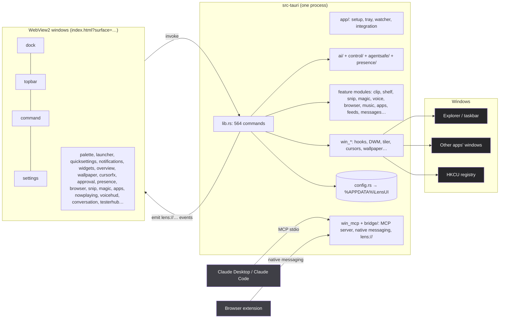

# Lens project brain

**This folder is living.** Read [IDENTITY.md](IDENTITY.md) first. This folder is the fastest way to understand Lens as it stands on `main`. Read it before you change anything. It was written on 22 November 2026 against `main` at `5a4a5b2` ("Lens at work", #39). The tables under `generated/` are rebuilt by `node tools/brain/refresh.mjs`, and a weekly workflow (`.github/workflows/brain.yml`) opens a PR when they drift.

## What Lens is

Lens is a Windows 10/11 desktop layer: a dock, a top bar, a launcher, quick settings, notifications, wallpapers and cursors that sit on top of (or replace) Explorer's shell. Around that core it has grown an AI layer: a Command palette that can do things on the PC, push-to-talk voice, a Shelf for gathering context, Snip, a magic menu, a built-in browser with an agent, Claude Desktop and Claude Code control over MCP, and an approval/safety system that keeps every agent action visible and reversible. The visual language is "Obsidian Monochrome" (see `DESIGN.md`), and the safety contract for every agent is `AGENTS.md`.

It is a Tauri v2 app: Rust (windows 0.58 crate) in `src-tauri/`, React 19 + Vite + TypeScript in `src/`, built and tested with bun. Nothing else runs on the user's machine: no services, no drivers. Everything Lens changes in Windows is recorded and undone by **Settings › About › Remove all Lens changes**.

## Size at a glance

| | |
|---|---|
| Source and docs | ~1,000 files, ~226k lines (`generated/loc.md`) |
| IPC commands | 564 in 40 command modules (`generated/commands.md`) |
| Windows | 21 declared in `tauri.conf.json` + 7 built at runtime; 27 frontend routes (`generated/windows.md`) |
| Tests | 630 bun tests in 35 files, 781 Rust `#[test]`s, real-Windows E2E (fluidity, visuals, a11y, soak), visual parity, nightly property tests |
| Open PRs | #40 AAA polish wave 1, #30 Site v2 (`generated/prs.md`) |

## One-page architecture

Three things to hold in your head:

1. **One Rust process, many WebViews.** Every surface is the same `index.html` with `?surface=<id>`; `src/main.tsx` lazy-loads the right React tree. Surfaces talk to Rust with `invoke` (typed by `src/types/generated.ts`) and listen to `lens://…` events.
2. **Everything Windows-specific lives in Rust behind hooks and threads** (`win_*.rs`, ~31k lines). Hooks have watchdogs; every OS change has a restore path that `win_uninstall.rs` calls.
3. **Every agent action goes through one gate.** Command, voice, MCP clients, the browser agent and the AI runner propose actions; `control/` previews and applies them, `agentsafe/` checks URLs and content, the approval surface asks the person, and `presence/` shows the AI acting on screen. Several callers still bypass `agentsafe_check` (see `BUGS.md` and `SCOPE.md`).

## How to read the rest

| File | Read it when |
|---|---|
| [IDENTITY.md](IDENTITY.md) | Always first: the mission (free, open source, local-first, reversible), naming, brand and aesthetic, motion and copy rules, and the safety contract on one page. |
| [COMBINATOR.md](COMBINATOR.md) | The long-running plan: Lens as the open-source combinator (link, bridge, rebuild light, learn), the licence rules, the Lens by Campton brand, the twice-weekly open-source scan and the horizons to 2027. Catalogue in [`docs/combinator/`](../combinator/). |
| [MODULES.md](MODULES.md) | The deep plan for modular Lens: a mandatory kernel, modules with requires/adjacent/enhances links, editions (Lens Dock first) built from the monorepo, generated mirror repos, coexistence and upgrades, and the checks that keep full Lens unbroken at every phase. |
| [FABLE_BRIEF.md](FABLE_BRIEF.md) | The standing contract for every deep Fable pass: what to read first, the project-wide bar (promises, look, DESIGN §5 feel, themes, module seams, licences), the deliverables per area (bugs, quick wins, polish, one big win, 3–5 UX/UI flourishes, dossier, real-PC list), the exact workflow and the self-review gate. |
| [ARCHITECTURE.md](ARCHITECTURE.md) | You need to know where something lives, which thread runs it, which window shows it, or what it writes to disk. |
| [FEATURES.md](FEATURES.md) | The all-time catalogue: every feature on `main` or in a PR with its status, the modern-rewrite foundations, and every suggested feature from reviews and research with a one-line why. |
| [SCOPE.md](SCOPE.md) | You are planning work: size, hotspots, duplicates to merge, dead code, risks, and the 1.0 bar. |
| [BUGS.md](BUGS.md) | Before fixing anything: what is known, what this pass fixed, what is open and who owns it. |
| [FLOWS.md](FLOWS.md) | You are changing UX: 12 end-to-end flows with their friction points and fixes. |
| [../WINDHAWK_REPLACEMENT.md](../WINDHAWK_REPLACEMENT.md) | You touch window styling: how Lens can drop the Windhawk dependency (recommendation: out-of-process first, opt-in allowlisted hook only if needed). |
| [LANDSCAPE.md](LANDSCAPE.md) | You need to know what Seelen, Raycast, PowerToys, Windhawk, Dia, Comet, Beeper, Wallpaper Engine and Windows itself did lately, and what Lens should do about it. |
| [../MISSION_CONTROL.md](../MISSION_CONTROL.md) | You run the project day to day: the dev-only admin window (CI, PRs, bugs, suggestions, real-PC checks, releases), its setup and its safety rules. |
| [FABLE_NEXT.md](FABLE_NEXT.md) | You are the next big pass. Paste-ready prompt, waves, gates and a first-30-minutes checklist. |
| `generated/*.md` | Machine-made inventories: commands, windows/routes, LOC, bug-pattern counts, open PRs. |

The per-feature design docs remain the source of truth for each package (`docs/COMMAND.md`, `docs/SHELF.md`, `docs/VOICE.md`, `docs/AGENT_SAFETY.md` and so on, about 30 of them). The brain links to them rather than repeating them.

## Rules that bite

- `AGENTS.md` is binding: no destructive file operations outside `%APPDATA%\LensUI` without confirmation, every OS change one-click reversible, no secrets in logs, no hooks into anti-cheat or fullscreen games, no native `title=` tooltips.
- CI is `-D warnings` clippy on Windows; the IPC types and the Guide index are generated files. After touching commands or settings, run `python3 tools/gen-types/gen_types.py` and `node tools/guide/build-index.mjs`. Merges conflict on those two files: take either side and regenerate.
- A new OS change must add its undo to `win_uninstall::remove_all_lens_changes` in the same PR. This pass found two that hadn't (Claude Desktop config, Spicetify theme) and fixed them.
- Other agents may be working in parallel branches. Check `git branch -r` and open PRs before editing shared files (`DockSurface.tsx`, `ControlCenterSurface.tsx`, `lib.rs`, CSS tokens).
