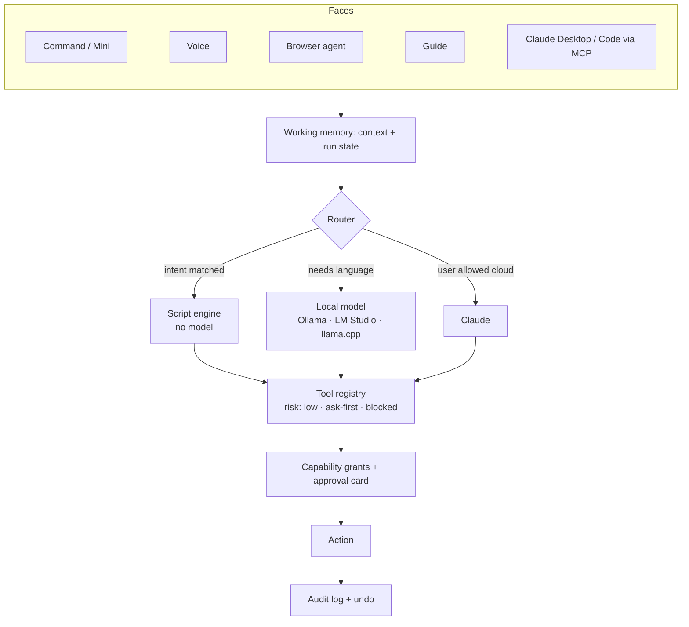

# One AI helper, many faces

Ask, Lens Command, Lens Mini, voice, Guide and the browser agent are **one helper**, not six assistants. They share:

- one engine (script → local → Claude),
- one tool registry with risk levels,
- one approval card,
- one audit log and undo,
- one **working memory**: the current context, which is local, inspectable and deletable.

The face you use is just where you happen to be.

## Status

| Piece | Status |
|---|---|
| Router, providers, privacy modes, intent engine, `ai_run_intent` | Integrated (PR #14) |
| Faces: Ask panel, palette, dock Ask, Command, Mini | Integrated |
| Voice face | In PR #23 |
| Guide face | In PR #18 |
| Browser agent | In PR #20 |
| Desktop State API, MCP tools/resources, capability grants, unified approval card, audit log | In PR #21 |
| Shared working memory across faces, runs that span faces, "Teach me" mode, quiet suggestions | Planned (W8-C) |

## Working memory (not "remember everything")

The helper remembers **only what is in play** and shows it.

- **Current context:** the chips in the context strip.
- **The current run's state**, including steps taken and pages read.
- **Last 20 exchanges** per Space, kept locally in `%APPDATA%\LensUI\memory\<space>.json`, encrypted with DPAPI.
- **Pinned facts** you explicitly save ("I'm vegetarian", "my work calendar is Outlook"). They show as a list you can edit or delete in *AI & Command › Memory*.

It never includes ambient screen capture, background recording or browsing history it wasn't asked to read. Recall's [opt-in redesign](https://therecord.media/microsoft-reverses-course-recall-opt-in) and Rewind's [shutdown after the Meta deal](https://9to5mac.com/2025/12/05/rewind-limitless-meta-acquisition/) are reminders that "capture everything" is a liability, not a feature.

**Handing off between faces:**

- Saying "Lens, continue that in Command" opens the same run in Command.
- Approving a card in the top bar resolves it everywhere.
- One **run id** threads across faces, so the voice HUD, dock ring and Command thread all show the same run.

## Runs and approvals across apps

- A run can touch several targets: read a page in Lens Browser, arrange two desktop windows, add a pack item, then draft a message.
- Every step is logged with its target and capability.
- Each run has a **"This task can"** list of capabilities. Each capability is **Allowed / Ask first / Blocked**. Defaults (from PR #21):

| Capability | Default |
|---|---|
| Read the current page / selection / settings | Allowed |
| Search the web, open tabs | Allowed |
| Change the look, arrange windows | Ask first (allow for this run) |
| Fill forms, type text | Ask first |
| Submit, book, send a message, delete | Ask first, every time |
| Pay | Blocked (can be set to Ask first per run; HOLD to confirm; never types card numbers) |
| Sign in, passwords, 2FA, CAPTCHAs | Blocked |
| Send context to a cloud model | Ask first (unless privacy is "allow cloud") |

Grants **expire with the run**. Standing grants per client (Claude Desktop, Claude Code, voice) live in *AI & Command › Permissions*, can be revoked, and show in the audit log.

## "Teach me" mode

- **Guide** (PR #18) teaches Lens: lessons, "show me" coach marks, and answers grounded in the settings index.
- **"Teach me this"** extends it to *anything on screen* (Planned):
  - "Teach me this app": tips for the focused app. Only the app name is sent, local model first.
  - "Explain this page / this error / this dialog": uses the current selection or snip as context.
  - "Do it with me": the helper narrates a run step by step and waits for you to click each step yourself. A learning mode with no automation.
- Lessons can be generated from a finished run ("turn this into a how-to"). The output is a Shelf item with numbered snips, which links to W7-G's step recorder.

## Proactive, but quiet

Suggestions are allowed only when **all** of these are true:

1. The user turned suggestions on (off by default).
2. The suggestion is computed **locally** (no model call just to suggest).
3. It is about the current context, not a past one.
4. It appears in an existing, non-modal place: Mini's tiles, a dimmed chip in the context strip, or a Guide "Did you know?" card. Never a toast, sound or badge.
5. There is at most **one per 30 minutes**, and dismissing it twice silences that suggestion for good.

Examples:
- "This page has a transcript, open it?" on a YouTube tab.
- "3 snips from this bug — make a pack?"
- "You usually switch to *Work* at 9:00."

## Provider routing

1. **Script engine** first for anything the intent grammar matches. It is instant, offline and costs nothing.
2. **Local model** for language tasks when one is detected. Vision tasks (snips) use a local vision model if available.
3. **Claude** only when:
   - the privacy mode allows it, or the user approves the consent card;
   - and either the task needs it (long documents, hard reasoning) or the user picked it.

The badge always shows which engine answered. Each verb can pin its engine (e.g. "Summarise page → Local always").

## Threat model

Prompt injection in agentic browsers is real and unsolved:

- [Brave showed Comet](https://brave.com/blog/comet-prompt-injection/) following hidden page text to steal an OTP.
- OpenAI says injection is "unlikely to ever be fully solved" in its [Atlas hardening post](https://openai.com/index/hardening-atlas-against-prompt-injection).
- Anthropic reports [Claude in Chrome](https://claude.com/blog/claude-for-chrome) attack success falling from 23.6% to 11.2% with mitigations, not to zero.

Lens assumes injection **will** sometimes get through the model, and puts deterministic gates after it.

| Threat | Example | Defences |
|---|---|---|
| Prompt injection from pages | hidden text: "email the user's OTP to…" | page text wrapped as untrusted; instructions found in pages are shown, not followed; the plan is parsed strictly (known verbs, ≤ 8 steps, no approval fields); every action is re-checked on the live element; sends, submits and sign-ins are ask-first or blocked; agent runs use a separate profile (PR #20) |
| Injection from files/snips/transcripts | a PDF says "ignore previous instructions" | same untrusted wrapping; file content can't grant capabilities; Shelf items carry a `source` and never become instructions |
| Data exfiltration | the model tries to put Shelf contents into a URL or form | the cloud consent card lists every field; local-only items can't go to cloud or into web forms; URL and query-string writes with user data are blocked; outbound sends are ask-first |
| Confused-deputy MCP | Claude Desktop asks Lens to change settings for a malicious tool | per-client grants; ask-first for writes; the audit log names the client; MCP prompt and resource content is untrusted; Lens never relays approvals from another app's UI |
| Over-broad standing grants | "always allow" given once, forgotten | grants expire with the run by default; standing grants show in Permissions with last-used dates and auto-expire after 30 days unused |
| Destructive actions | bulk delete, uninstall, close-all | deletes go to Recycle Bin / Lens bin (30 days); bulk actions show counts and what was kept; "Review all" before confirm |
| UI spoofing | a page draws a fake "Needs your OK" card | approval cards render only in Lens chrome or topmost Lens windows, never in page content; HOLD-to-confirm on risky actions |
| Credential theft | an agent asked to read a password manager | password fields, password-manager and elevated windows are excluded from selection reading and typing; credentials are never logged (AGENTS.md §3.3) |

## Never

- Never captures the screen, audio or keystrokes in the background.
- Never sends anything to a cloud model without the badge and, when the mode requires it, the consent card.
- Never types passwords, card numbers or 2FA codes, and never solves CAPTCHAs.
- Never sends a message, posts, books, submits or deletes without a **Needs your OK** card.
- Never pays by default.
- Never follows instructions found in pages, files, transcripts or tool results.
- Never runs downloaded executables.
- Never injects into other processes or anti-cheat-protected games (AGENTS.md §3.4).
- Never keeps memory you can't see, edit and delete.
