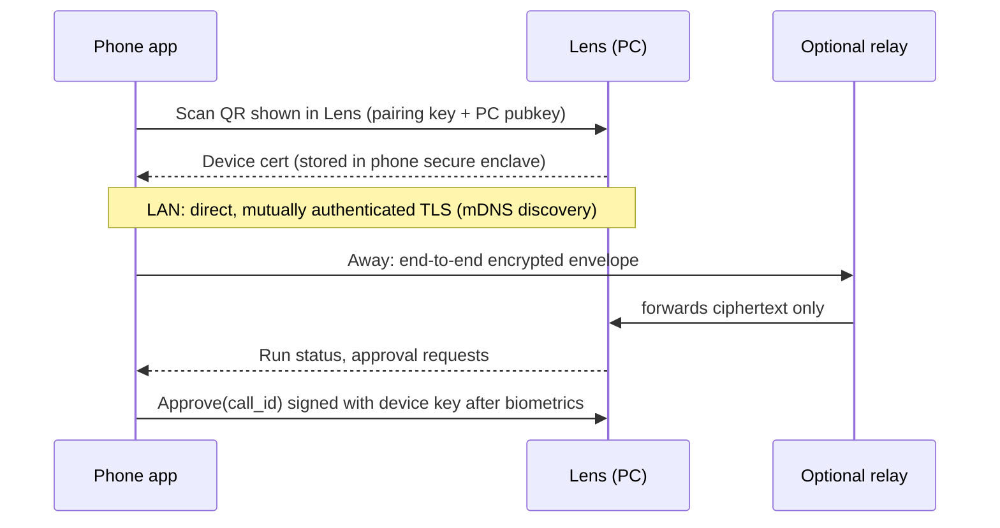

# Roadmap: W8 and beyond

W8 starts after `integration/waves-4-6` merges to `main` and the W7 packages (PRs #18–#24) land on the next integration branch, `integration/wave-7`. The same rules as [MASTERPLAN](../MASTERPLAN.md) apply:

- strict file ownership;
- snippets for shared files;
- one integration PR per wave;
- off by default;
- undoable;
- tester steps for every feature.

## Packages

| Package | Scope | Owns (file areas) | Depends on | Acceptance |
|---|---|---|---|---|
| **W8-A Web apps on the dock** | "Pin as app", chromeless web-app windows, badges, web apps in Alt+Tab/Overview/rules | `src/browser/webapp/*`, `src-tauri/src/browser/webapp.rs`, `src/dock/webapps.ts` | PR #20, #8 | Pinned web app launches < 600 ms warm; behaves as a real window for snapping, rules and dimming; badge updates ≤ 30 s |
| **W8-B Desktop-wide Spaces** | Space owns tabs, windows, workspace, scene, pack, DND, dock profile, accent; switcher in dock/top bar/Command/voice | `src-tauri/src/spaces/*`, `src/spaces/*` | PR #20, W5-F profiles, #19 packs | Switch < 300 ms; exact restore after reboot; undo returns the previous Space; untagged windows untouched by default |
| **W8-C One helper** | Shared working memory, run ids across faces, Memory page (view/edit/delete), Teach-me and "Do it with me", quiet-suggestion engine | `src-tauri/src/ai/memory.rs`, `src-tauri/src/ai/runs.rs`, `src/ai/memory/*`, `src/ai/suggest/*` | PR #14, #21, #18 | Memory is fully inspectable/deletable; a run started by voice resolves in Command and the dock; suggestions follow the 5 rules in [ai-helper](ai-helper.md#proactive-but-quiet) |
| **W8-D Routines** | Named, no-model routines ("morning", "focus 50") made of catalogue verbs, editable as cards, triggerable by voice/hotkey/time | `src/routines/*`, `src-tauri/src/routines/*` | #21 Desktop State API, #23 voice | A routine is one approval and one undo; dry-run preview; runs offline |
| **W8-E Dock × Browser fusion** | Tab list hover, tabs-as-icons, run rings and approval dots, media hover controls, downloads stack, tear-off/re-dock | `src/dock/browser/*`, `src-tauri/src/browser/tearoff.rs` | PR #8, #20, #21 | Zero dock widening; run ring is event-driven; tear-off keeps the webview with no reload |
| **W8-F Rich results** | Comparison table, map, place, product, flight cards in Command, browser and phone; "My pick" with reasons | `src/results/*` | PR #16, #20 | Every card is Shelf-able, copyable as Markdown and keyboard-navigable |
| **W8-G File tidy tools** | Desktop and Downloads grouping, move-to-archive, recycle with counts; registry tools | `src-tauri/src/control/files.rs` | PR #21 | Never deletes outside Recycle Bin; one undo restores every path |
| **W8-H Phone companion** | Pairing, approvals inbox, run status, voice remote, "continue on PC" (see below) | `companion/*` (new app), `src-tauri/src/companion/*` | PR #21, W8-C | Pairing needs a physical QR scan; approvals need on-phone biometrics; works on LAN with no account |
| **W8-I Site, docs and demos** | README rewrite, Pages site with GIFs, live dock widget, interactive concept demos, an on-site "Ask Lens" guide over the docs | `docs/site/*`, `README.md`, `tools/site/*` | PR #1, #18 index | Lighthouse ≥ 95; every feature has a ≤ 6 s GIF; the site's guide answers from the docs index only |
| **W8-J Dither material** | Lens-wide dither/grain tokens and generator; presentation backdrops | `src/style/dither.*` (from #20 follow-up) | PR #20 | Off in high contrast; static with reduced motion; ≤ 1 ms per frame when animated |

## Phone companion

**Goal:** see and approve what Lens is doing when you're away from the PC, and talk to it.

**Features:**
- an approvals inbox (the same card anatomy);
- run status and timelines;
- a voice remote (push-to-talk, which sends audio to the PC's local recogniser);
- "continue on PC" for packs and runs;
- "lock my PC".

**Security model:**
- Pairing needs physical presence (QR).
- Each approval is signed on the phone after biometric unlock.
- Lens accepts approvals only for pending call ids, and they expire after 5 minutes.
- The relay, if used, sees ciphertext only. It is optional and self-hostable.
- Revoke a phone from *AI & Command › Devices*.
- The phone can never widen grants, only answer existing approval requests.

**Out of scope:** remote desktop and screen streaming, and file access from the phone beyond Shelf items.

## Metrics (added to the MASTERPLAN dashboard)

| Metric | Target at W8 end |
|---|---|
| Space switch time p95 | ≤ 300 ms |
| Web app cold launch p95 | ≤ 1.2 s; warm ≤ 600 ms |
| Approval card render after request | ≤ 100 ms |
| Runs completed without user correction (tester-graded) | ≥ 70 % |
| Injection test suite (W7-B fixtures + new hostile pages) blocked at the gate | 100 % of deterministic gates hold |
| Share of AI requests served locally (script + local) | ≥ 80 % for users with a local model |
| Feature GIF coverage on the site | 100 % of shipped features |
| Memory items users delete or edit (signal of trust) | tracked, no target |
