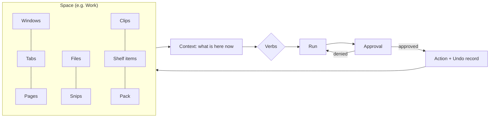
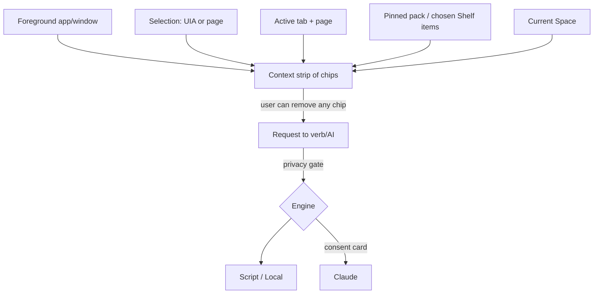
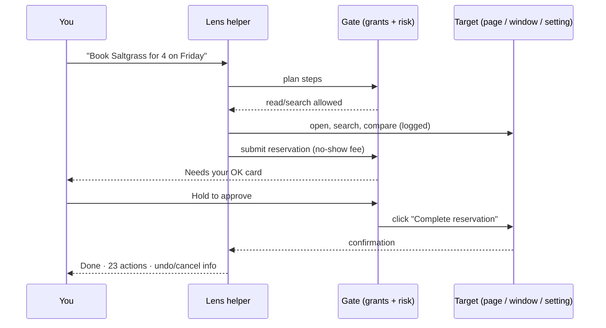

# The unified model

Every Lens surface reads and writes the same small set of **objects**, using the same **verbs**, scoped by the current **context**, inside a **Space**. Agent work is a **Run**, and anything risky inside a run is an **Approval**.

This is the contract that makes the dock, browser, Command, voice and AI feel like one product.

## Objects

| Object | What it is | Identity | Status |
|---|---|---|---|
| **App** | An installed program or a pinned web app | exe path / AUMID / web-app origin | Integrated (desktop apps); Planned (web apps as apps) |
| **Window** | A top-level window of an app | HWND plus stable key (app + title class) | Integrated |
| **Tab** | A Lens Browser tab | tab id, URL | In PR #20 |
| **Space** | A named working context spanning browser and desktop | space id | In PR #20 (browser only); Planned (desktop-wide) |
| **Page** | The readable content of a tab or URL | URL + content hash | Integrated (extension), In PR #20 |
| **File** | A file or folder | path | Integrated (Explorer verbs) |
| **Snip** | An image or recording captured on purpose | snip id | In PR #24 |
| **Clip** | A clipboard history entry | clip id | Integrated (opt-in) |
| **Shelf item** | A saved piece of context: text, page, selection, file, image, transcript, answer | item id | Integrated |
| **Pack** | An ordered, budgeted bundle of Shelf items | pack id | In PR #19 |
| **Run** | One agent task, with steps, a timeline and an outcome | run id | Partial (Command thread, browser agent in PR #20) |
| **Approval** | A pending risky action inside a run | call id | In PR #21 |

Rules:

- Every object has a **title, icon, source and owner Space**.
- Every object can be shown as a **chip** in any context strip.
- Every object can be dragged to the **Shelf**.

## Verbs

Verbs are the shared action catalogue ([RIGHTCLICK.md](../RIGHTCLICK.md), In PR #19). A verb declares which objects it applies to, its default engine (script / local / Claude) and its risk.

| Group | Verbs | Risk |
|---|---|---|
| Understand | ask, summarise, explain, translate, extract, compare, transcribe | low (local) · ask-first (cloud) |
| Keep | micro-save, add to Shelf, add to pack, copy as Markdown, pin | low |
| Arrange | open, focus, snap, move to monitor/workspace/Space, minimise, close | low · close is ask-first |
| Change look | theme, accent, dock style, wallpaper/scene, density | low, always undoable |
| Act on the web | click, type, fill form, submit, book, send, pay | submit/book/send ask first · pay blocked by default |
| Remove | delete, clear, unsubscribe | ask first · always to a bin |

One catalogue serves the right-click menus, Command `/` commands, voice phrases, Guide answers and MCP tools. A verb added once appears everywhere it applies.

## Context: "what is here"

Context is the set of objects the user is pointing at *right now*. It is computed, shown and never sent silently.

- Every surface shows the same **context strip** of removable chips: Command, Mini, browser side panel, voice HUD.
- The strip shows **where** the request will run: Local / Claude badge.
- Context has a size meter. Over budget, Lens proposes trimming (local summarise) rather than truncating silently.
- Context sources are opt-in per type: selection, clipboard, window title, page, files.

## Runs

A **Run** is any multi-step task done by the helper: a browser agent task, a "set up my morning" voice command, a Claude Desktop MCP session.

What a Run has:

- a title, a Space, a status (working / waiting for OK / done / failed / cancelled), elapsed time and action count;
- a timeline of grouped steps with monospace captions;
- capabilities: the "This task can" list, see [ai-helper.md](ai-helper.md);
- approvals;
- an outcome card with an undo or cancel route.

Where Runs appear:

- in the Command thread;
- on the dock as a progress ring (see [dock-browser.md](dock-browser.md));
- in the top bar's "Approve N actions" pill;
- in a future phone companion.

## Spaces

A **Space** is the unit of "what I'm doing". Today Spaces exist only inside Lens Browser (In PR #20). The vision makes a Space desktop-wide.

| A Space owns | Notes | Status |
|---|---|---|
| Browser tabs, folders and pinned sites | own WebView2 profile per Space | In PR #20 |
| Desktop windows | windows opened while in a Space are tagged to it | Planned |
| Virtual workspace | maps onto Lens workspaces | Integrated (workspaces), Planned (mapping) |
| Wallpaper / Playground scene | scene per workspace already exists | Integrated, Planned (per Space) |
| Shelf pack | the Space's active context pack | In PR #19, Planned (binding) |
| Focus mode / DND schedule | e.g. "Deep work" Space silences notifications | Integrated (DND), Planned (binding) |
| Dock profile | pinned apps, web apps and style per Space | Planned (W5-F profiles + binding) |
| Theme accent | optional per-Space accent so you always know where you are | Planned |

**Switching a Space** happens from the dock, top bar, Command (`/space work`), voice ("Lens, work mode") or Ctrl+Win+1…9. It:

1. snapshots the current Space (open windows and tabs, positions);
2. hides or minimises windows tagged to other Spaces, with a setting to leave untagged windows alone;
3. restores this Space's windows, tabs, workspace, wallpaper, dock profile, pack and focus mode;
4. takes under 300 ms on mid-range hardware, with no animation if reduced motion is on.

Undo returns you to the previous Space exactly.

## Surfaces are views

| Surface | Objects it shows | Main verbs | Status |
|---|---|---|---|
| **Dock** | Apps, Windows, Tabs (grouped), web apps, Runs, Downloads, media | open/focus, arrange, drop-to-verb, approve | Integrated (apps/windows); Planned (tabs, runs, downloads) |
| **Top bar** | Space, Runs ("Approve N"), clock, status, voice mic | switch Space, approve, open Command | Integrated (bar); In PR #21 (pill) |
| **Lens Command** | Everything; thread of Runs | all verbs, `/` commands, `@` context | Integrated |
| **Lens Mini** | Context + 6 verb tiles + Shelf strip | quick verbs | Integrated |
| **Lens Browser** | Tabs, Pages, Spaces, Runs | web verbs, agent, transcripts | In PR #20 |
| **Voice** | Context, Runs | any verb by phrase; confirm by voice | In PR #23 |
| **Snip** | Snips | annotate, redact, copy, paste to Claude, share, Shelf | In PR #24 |
| **Right-click** | Whatever was clicked | catalogue verbs for that object | In PR #19 |
| **Guide** | Settings, lessons, the catalogue | teach, "show me" | In PR #18 |
| **Shelf / Edge Shelf** | Shelf items, Packs | save, pack, send as context | Integrated |

**Design rule:** a new feature is added as an object, a verb or a view, never as a new silo. If it doesn't fit the table, the model is extended first.
